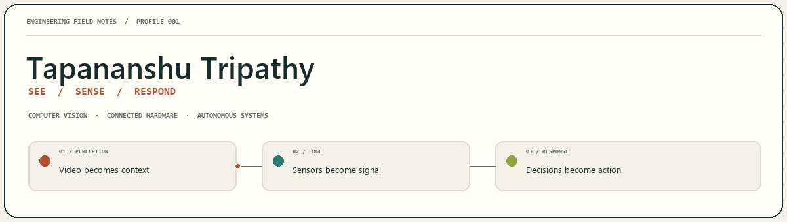
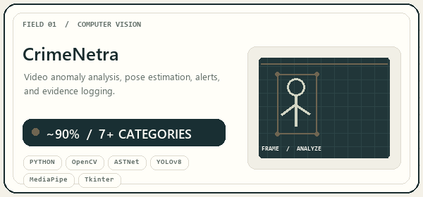
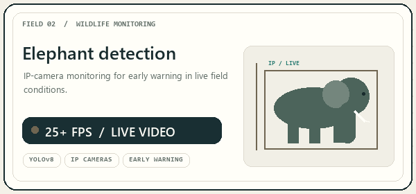
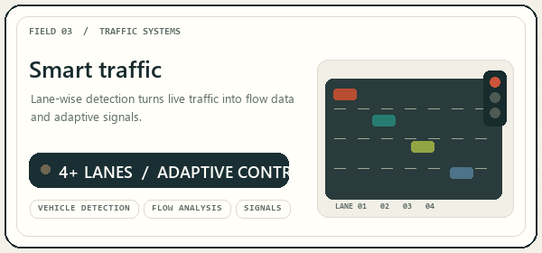
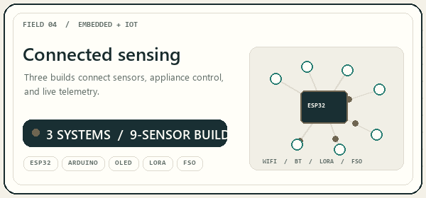
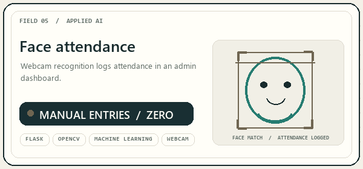
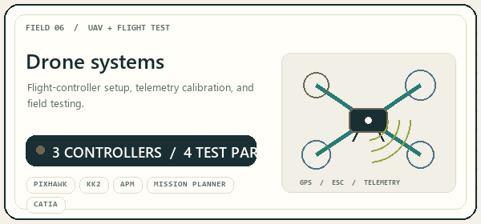

# Tapananshu Tripathy

  

  <a href="https://www.linkedin.com/in/tapananshutripathy">LINKEDIN</a>
  &nbsp; / &nbsp;
  <a href="mailto:tapananshutripathy13052006@outlook.com">EMAIL</a>

> **Computer Science undergraduate · Data Science · KIIT University, 2024–2028**  
> Bhubaneswar, India · Building where computer vision, embedded systems, and the physical world meet.

## 01 / The work

I build systems that turn **images and sensor readings into useful action**: video analytics that raises an alert, connected devices that monitor a space, and intelligent hardware that can respond in the field. My experience spans applied AI/ML, computer vision, IoT, embedded electronics, UAV systems, and industrial technology.

## 02 / Selected builds

<table>
  <tr>
    <td width="50%" valign="top">
      
      
Real-time desktop surveillance for webcam, video, and RTSP/IP streams. ASTNet anomaly analysis, YOLOv8 detection, and MediaPipe pose estimation drive adaptive thresholds, live alerts, and evidence logging in a Tkinter interface.

      
<code>Python</code> <code>OpenCV</code> <code>ASTNet</code> <code>YOLOv8</code> <code>MediaPipe</code> <code>Tkinter</code>

    </td>
    <td width="50%" valign="top">
      
      
An IP-camera wildlife monitor built to support early warnings for human–elephant conflict, processing live video at 25+ FPS.

      
<code>YOLOv8</code> <code>IP cameras</code> <code>Real-time video</code>

    </td>
  </tr>
  <tr>
    <td width="50%" valign="top">
      
      
Supported deployment of lane-wise vehicle detection across 4+ lanes, enabling real-time traffic-flow analysis and adaptive signal control.

      
<code>Vehicle detection</code> <code>Traffic analysis</code> <code>Adaptive signals</code>

    </td>
    <td width="50%" valign="top">
      
      
Built three ESP32 and Arduino IoT systems for environmental, safety, and energy monitoring. They combine a nine-sensor suite, OLED readouts, browser controls, relays, and four communication modes. The smart-home build used Arduino Cloud for fan and light control; the energy build added sensor-triggered control of 4+ appliances, live diagnostics, and bill estimation.

      
<code>ESP32</code> <code>Arduino</code> <code>OLED</code> <code>Wi-Fi</code> <code>Bluetooth</code> <code>LoRa</code> <code>FSO</code>

    </td>
  </tr>
  <tr>
    <td width="50%" valign="top">
      
      
A Flask and OpenCV webcam system with an admin dashboard, automating attendance logging and reducing manual entries to zero.

      
<code>Flask</code> <code>OpenCV</code> <code>Machine learning</code> <code>Web dashboard</code>

    </td>
    <td width="50%" valign="top">
      
      
Assembled and tested drones across Pixhawk, KK2, and APM flight controllers; configured GPS, telemetry, ESCs, and flight sensors, then designed 3D parts and explored autonomous, vision-enabled flight.

      
<code>Pixhawk</code> <code>KK2</code> <code>APM</code> <code>Mission Planner</code> <code>CATIA</code>

    </td>
  </tr>
</table>

## 03 / GitHub telemetry

<table>
  <tr>
    <td width="50%" valign="top">
      
    </td>
    <td width="50%" valign="top">
      
    </td>
  </tr>
</table>

  

  

  

  <picture>
    <source media="(prefers-color-scheme: dark)" srcset="https://raw.githubusercontent.com/TAPANANSHUTRIPATHY/TAPANANSHUTRIPATHY/output/github-contribution-grid-snake-dark.svg" />
    
  </picture>

## 04 / Technology atlas

A catalog of tools and systems named in my profile, grouped by the work they supported.

| Field | Tools and technologies |
|:--|:--|
| **AI, vision & application layer** | Python · Deep Learning · Machine Learning · OpenCV · ASTNet · YOLOv8 · MediaPipe · Flask · Tkinter · RTSP · IP cameras · webcams · video and stream inputs |
| **Embedded & connected devices** | ESP32 · Arduino Uno · Arduino Mega · Arduino Cloud · OLED · relay modules · browser-based control panels · Wi-Fi · Bluetooth · LoRa · Free Space Optics (FSO) |
| **Sensor suite** | DHT11 · BMP085 · MPU6050 · MQ135 · flame sensor · piezo sensor · ACS712 · ZMPT101B |
| **UAV, electronics & fabrication** | Pixhawk · KK2 · APM · Mission Planner · GPS · telemetry · ESC · gyroscopes · accelerometers · compasses · EagleCAD · PCB design · TINA Suites · CATIA · ANYCUBIC 3D printing · ground control stations · wireless telemetry |
| **Industrial & enterprise systems** | SAP · ERP · PLC · SCADA · industrial networking · data-center and server infrastructure · AI-based predictive maintenance |
| **Databases** | Oracle Forms · Oracle Database |

**Additional systems work:** manual-override circuits · thrust-stand testing · lift, drag, thrust, and torque measurements · battery safety · current sensing · power distribution · autonomous flight · onboard object detection and decision-making · IoT swarm coordination.

**Specialist sessions:** PCB design with TINA Suites (Scientech Technologies) · AI/ML applications with Shuchismita Sahu (Inflera.ai).

## 05 / Field experience

| When | Work |
|:--|:--|
| **Sep 2026–present** | Senior Executive, Microsoft Learn Student Ambassadors — KIIT Chapter |
| **Aug 2025–present** | General Volunteer, National Service Scheme — Project Udaan; community initiatives aligned with SDGs 5 and 10 |
| **Jun–Jul 2026** | Summer Intern, Department of Computer Science & Engineering, NIT Rourkela |
| **May–Jun 2026** | Summer Intern, C&IT Department, Steel Authority of India Limited — Rourkela Steel Plant; exposure to SAP/ERP, PLC/SCADA, industrial networks, data-center infrastructure, and predictive maintenance |
| **Oct 2025–Feb 2026** | McKinsey Forward Program Scholar |
| **May–Jul 2025** | AI/ML Intern, NIT Rourkela Department of Electronics & Telecommunication Engineering, in collaboration with eWarn Systems |
| **Jun 2025** | Drone Assembly Bootcamp, NIT Rourkela — Project SwaYaan (MeitY) |
| **May–Jul 2025** | AI/ML/IoT Development Intern, eWarn Systems Pvt. Ltd. |
| **Jul–Aug 2024** | Web Development Internships: CipherByte Technologies · CodeAlpha · Oasis Infobyte |

  
<strong>Flight-test notebook</strong>

   

- Completed a five-day build and flight-testing program; configured three flight-controller platforms and calibrated GPS, telemetry, ESCs, gyroscopes, accelerometers, and compasses using Mission Planner.
- Built airframes from components, integrated motors and wiring, and ran thrust-stand tests across lift, drag, thrust, and torque.
- Worked with battery-safety mechanisms, current sensing, and power distribution; explored AI-assisted object detection, autonomous flight, and IoT-based multi-drone telemetry.
- Designed drone components in CATIA and prototyped with ANYCUBIC 3D printing.

## 06 / Education & credentials

**B.Tech, Computer Science Engineering (Data Science)** — Kalinga Institute of Industrial Technology (KIIT), 2024–2028.

**Certifications:** Introduction to Microsoft Excel · Efficient Green Hydrogen Storage and Transportation: Techniques and Innovations · Web Development Fundamentals · Cyber Security Awareness Programme · Role of AI/ML in Electrical, Electronics and Biomedical Engineering Applications (RAEEBEA-2024).

**Languages:** Odia and Hindi — full professional proficiency · English — professional working proficiency.

## 07 / Contact

For computer vision, AI/ML, connected devices, embedded systems, and applied engineering collaborations:

**[LinkedIn](https://www.linkedin.com/in/tapananshutripathy)** · **[Email](mailto:tapananshutripathy13052006@outlook.com)**
