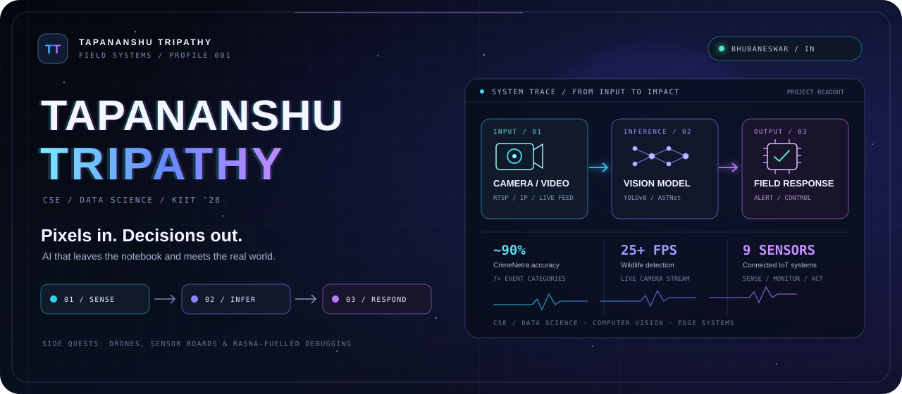

<p align="center">
  
</p>

<p align="center">
  <a href="https://tapananshutripathyportfolio.vercel.app">OPEN PORTFOLIO ↗</a>
  &nbsp; / &nbsp;
  <a href="https://www.linkedin.com/in/tapananshutripathy">LINKEDIN ↗</a>
  &nbsp; / &nbsp;
  <a href="mailto:tapananshutripathy13052006@outlook.com">CONTACT ↗</a>
</p>

**Namaste, internet.** I'm Tapananshu: a Computer Science undergraduate at KIIT University, specializing in Data Science ('28), based in Bhubaneswar, India.

I like working at the seam between **software and the physical world**: a camera becomes a signal, a model turns it into a decision, and a device or person can act on it. Computer vision, embedded systems, and real-time interfaces are where I spend most of my build time.

## 01 / Systems log

### `01` CrimeNetra // video into context

A real-time desktop surveillance system for camera, video, and stream input. RTSP/IP feeds are analyzed with ASTNet, YOLOv8, and MediaPipe; adaptive thresholds drive live alerts and evidence logging in a Tkinter app.

**Readout:** about **90% detection accuracy** across **7+ crime and harassment categories**.

`Python` `OpenCV` `ASTNet` `YOLOv8` `MediaPipe` `Tkinter`

### `02` Elephant detection // eyes on the edge

An IP-camera wildlife monitor processing live video at **25+ FPS** to support early warnings for human-elephant conflict.

`YOLOv8` `Computer Vision` `IP Cameras` `Real-time inference`

### `03` Smart traffic // lane by lane

Supported deployment of lane-wise vehicle detection across **4+ lanes**, turning live traffic into flow analysis and adaptive signal control.

`Vehicle detection` `Traffic analysis` `Adaptive signals`

### `04` Sensor rig // measure, then respond

Built three end-to-end IoT systems for environmental, safety, and energy monitoring using ESP32 and Arduino with a **9-sensor suite**. OLED readouts and a browser control panel bring the telemetry back to people. The build included Wi-Fi, Bluetooth, LoRa, and free-space optical communication.

Also built a Flask/OpenCV face-recognition attendance system with an admin dashboard, automating attendance logging and eliminating manual entries.

`ESP32` `Arduino` `Flask` `OpenCV` `OLED` `LoRa` `FSO`

## 02 / Operations log

- **Now** — Senior Executive, Microsoft Learn Student Ambassadors, KIIT Chapter *(Sep 2026-present)*; General Volunteer, NSS SCE KIIT's Project Udaan *(Aug 2025-present)*.
- **Summer 2026** — Intern, Computer Science & Engineering, NIT Rourkela *(Jun-Jul)*; Intern, C&IT Department, Steel Authority of India Limited, Rourkela Steel Plant *(May-Jun)*. At SAIL I got a close look at SAP/ERP, PLC/SCADA, industrial networks, data-center infrastructure, and predictive maintenance.
- **2025** — AI/ML Intern at NIT Rourkela's Department of ECE with eWarn Systems, and AI/ML/IoT Development Intern at eWarn Systems *(May-Jul)*.

<details>
  <summary><strong>Earlier transmissions / programs and credentials</strong></summary>
  <br>

- **McKinsey Forward Program Scholar** *(Oct 2025-Feb 2026)*
- **Drone Assembly Bootcamp**, NIT Rourkela's Project SwaYaan (MeitY) *(Jun 2025)* — 5-day build and flight-testing program using Pixhawk, KK2, and APM; worked with Mission Planner, CATIA, and 3D-printed components.
- **Web development internships** — CipherByte Technologies, CodeAlpha, and Oasis Infobyte *(Jul-Aug 2024)*

**Certifications:** Introduction to Microsoft Excel · Efficient Green Hydrogen Storage and Transportation: Techniques and Innovations · Web Development Fundamentals · Cyber Security Awareness Programme · Role of AI/ML in Electrical, Electronics and Biomedical Engineering Applications (RAEEBEA-2024)

**Languages:** Odia and Hindi (full professional) · English (professional working)
</details>

## 03 / Instrument panel

```text
VISION      Python / OpenCV / ASTNet / YOLOv8 / MediaPipe
INTERFACES  Flask / Tkinter / OLED / browser dashboards
EDGE        ESP32 / Arduino / Wi-Fi / Bluetooth / LoRa / FSO
LAB         EagleCAD / CATIA / Pixhawk / Mission Planner
DATABASE    Oracle Forms / Oracle Database
```

## 04 / Open channel

If you're building something where **AI meets cameras, sensors, or hardware**, I'd love to hear about it.

**[Portfolio](https://tapananshutripathyportfolio.vercel.app)** · **[LinkedIn](https://www.linkedin.com/in/tapananshutripathy)** · **[Email](mailto:tapananshutripathy13052006@outlook.com)**

<sub>Side quest: I debugged my first JavaScript loop over Rasna. Still here, still building.</sub>
